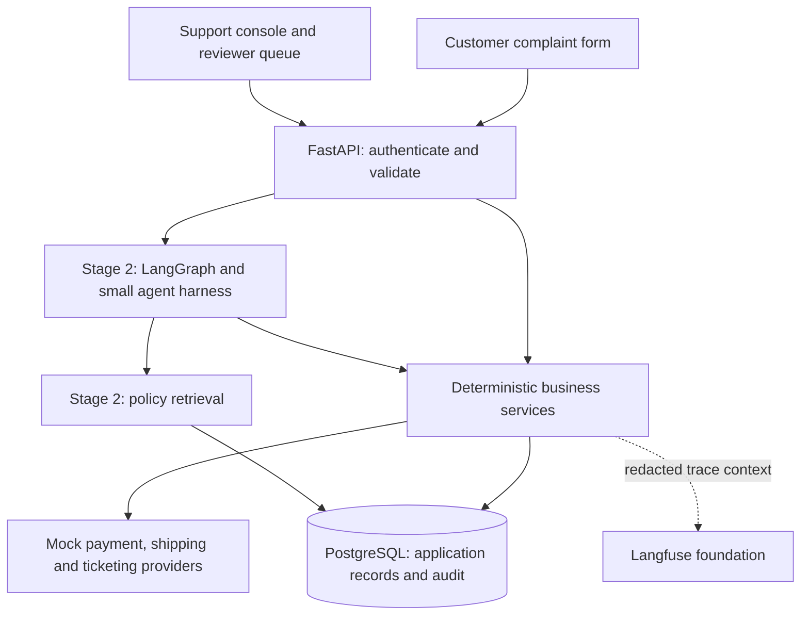

# Architecture proposal and database walkthrough

Status: proposed for discussion. Confirmed constraints come from the original plan and
the subsequent Stage 1 instructions; implementation choices below are not all final.

## One application with explicit responsibilities

Start with one Python backend and one PostgreSQL application database. Do not introduce
microservices or a general plugin system. Later workers can run the same application
services in a separate process without becoming a separate product or business service.

The diagram describes responsibilities, not a requirement to implement every component
in Stage 1. Models can request permitted reads and create proposals through controlled
tools. Only the deterministic execution service performs approved financial writes.

## Technology decisions

| Area | Proposed choice | Reason and timing |
| --- | --- | --- |
| API | Python, FastAPI, Pydantic | Typed boundaries and validation; Stage 1 |
| Persistence | PostgreSQL, SQLAlchemy, Alembic | Transaction controls, relational constraints, reproducible schema; Stage 1 |
| Development | uv, pytest, Ruff, Docker Compose | Locked dependencies, tests, formatting and local services; foundation |
| Interface | React and TypeScript | Proposed support console; choose details when UI work starts |
| Agent workflow | LangGraph | Persisted agent state and routing; Stage 2 |
| Agent controls | Small application-specific harness | Tool allowlists, injected identity, validation and budgets; Stage 2 |
| Retrieval | Versioned policies in PostgreSQL; optional pgvector | Add retrieval in Stage 2; no separate vector database initially |
| Model calls | One evaluated provider/model, optional development gateway | FreeLLMAPI only for synthetic experiments; no routing dependency in Stage 1 |
| Observability | Langfuse configuration, trace helper and stored trace ID | Minimum Stage 1 foundation; no agent tracing yet |
| Application tracing | OpenTelemetry later | Explicitly excluded from Stage 1 despite the original plan's broader wording |
| Delivery | Local Git, proposed GitHub Actions CI | Confirm remote destination before publishing; grow checks with working features |

Choose and lock exact versions during the foundation milestone. Do not assume free
software means free hosting or free model inference. Do not put credentials in Git.
Temporal, Paperclip, Nod, and DeepSeek Harness are research references, not dependencies.

## Database responsibilities

| Records | What they establish |
| --- | --- |
| customers | Customer identity mapping; never infer identity from a submitted email |
| orders, order_items | Ownership, purchased items, currency, paid amounts |
| products, payments, deliveries | Explicit synthetic catalog and payment/shipping facts; additions supporting required seed scenarios |
| returns | Return progress, request/receipt dates, inspection evidence |
| tickets | The customer issue and support status |
| workflow_runs | One investigation/execution attempt, state, configuration and trace ID |
| policy_documents, policy_chunks | Policy versions, effective periods, text and references; embeddings deferred |
| action_proposals | Exact immutable action requested; payload and integrity hash |
| approvals | Authenticated decision, reviewer, timestamps, expiry and approved payload binding |
| refund_operations | Reserved/committed amounts, stable idempotency key, provider reference and outcome |
| audit_events | Append-only, minimal business evidence of who did what |

Every application table carries `tenant_id`. Tenant-scoped foreign keys prevent a row
from referencing another tenant's customer, order, or proposal. Service checks must also
verify customer ownership: matching tenants alone is insufficient. Tenant-aware schema
does not by itself establish complete production tenant isolation.

Store money as integer minor units, with explicit currency. For example, INR 2,499.00
is 249900 paise. Never use floating point for eligibility, limits, or accounting.

Keep workflow checkpoint tables logically separate from the application ledger. A
workflow's saved position is not proof that a provider completed a refund.

## Safe execution, explained

Suppose an order was paid 249900 minor units. Two requests must not each see that entire
amount as available and both issue refunds.

1. In a short transaction, lock the order, load the stored proposal and approval, and
   revalidate ownership, permissions, expiry, evidence, amount and available balance.
2. Create or identify one durable refund operation with a stable idempotency key. Reserve
   its amount. A unique constraint prevents multiple operations for the same proposal.
3. Commit. This releases database locks before the provider call.
4. Call the provider using the persisted key and exact payload.
5. In another short transaction, persist the result exactly once. Success moves the amount
   from reserved to refunded. Confirmed terminal failure releases the reservation.
6. Timeout or uncertain outcome retains the reservation and enters reconciliation. Query
   the provider before deciding whether retry is permitted. Never create a fresh key just
   because a response was lost.

Maintain `refunded + reserved <= paid` using database constraints and serialized service
updates. The execution and reconciliation paths must use compatible lock ordering and
terminal-state checks, so concurrent completion cannot apply accounting twice.

Provider status remains distinct from workflow and ticket status. `submitted`,
`processing`, `succeeded`, `failed`, and `pending_reconciliation` mean different things.
A missing provider lookup result is not automatically proof that a timed-out request
could never complete. Retry behavior follows the provider's documented contract.

## Failure and privacy boundaries

- Mock provider state must survive application restarts independently of the application
  transaction. Choose its storage/transport during Stage 1 design.
- Payment, shipping and ticketing mocks exercise success, delay, timeout, duplicates,
  provider errors and uncertain outcomes where applicable.
- Financial success survives ticket synchronization failure. Retry ticket updates separately.
- Audit events belong in PostgreSQL, with restricted mutation. ORM hooks alone do not
  establish database-enforced append-only storage.
- Observability receives allowlisted identifiers and redacted metadata; avoid raw customer
  complaints, emails, addresses, and credentials by default.
- Persist operations and workflow state in Stage 1; durable worker scheduling and periodic
  reconciliation sweep arrive in Stage 3. Manual recovery endpoints are required earlier.

## Questions for the architecture walkthrough

Explain and agree on: the proposed synthetic refund rules, policy effective-date selection,
development authentication and reviewer roles, provider contract, refund state transitions,
and the first concurrency test. Review the early draft code only after these decisions.
